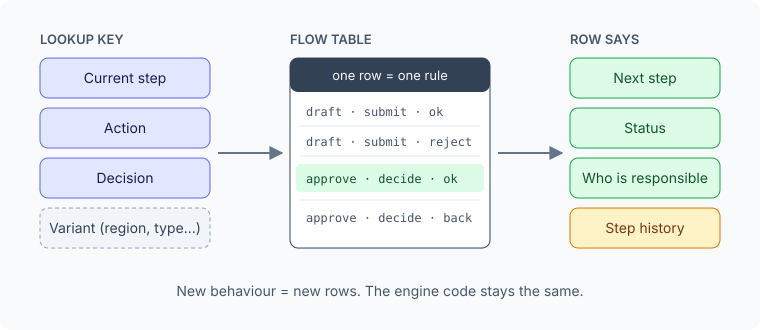

SAP üzerinde çok adımlı bir onay akışından notlar: bir talep oluşturuluyor, birkaç onay adımından geçiyor ve kapatılıyor. İki farklı süreç aynı omurgayı paylaşıyor.

## Geçişler kod değil, satır

Çekirdekte **veri odaklı bir durum makinesi** var. Motor `mevcut adım + aksiyon + karar` ile bir satır arıyor; satır bir sonraki adımı, durumu ve sorumluyu söylüyor. Bölge ya da talep türü gibi koşullar ek kolon değil, satırdaki bir **varyant anahtarı**.

Dolayısıyla kural şu: **adıma özel kod yok.** Yeni bir adım, yeni bir satır demek. İki süreç de tek motor ve tek tablo üzerinde çalışıyor.

## Modele uymayanlar için bir kayıt defteri

Modele uymayan kurallar, dağınık `IF` blokları yerine bir **özel durum kayıt defterine** gidiyor. Yeni özel durum türü hiç eklenmiyor, kayıtlar silinmek yerine pasife alınıyor ve her aktif kaydın uçtan uca bir testle kapsanması gerekiyor.

## İki durum, asla karışmıyor

**İç durum** küçük bir yaşam döngüsü kümesi (oluşturuldu, bekliyor, reddedildi, tamamlandı). **Dış durum** ise her rolün gördüğü metin. "Beklemede" için yeni bir duruma gerek kalmadı; bir bekleme adımı ve eşlenmiş bir metin yetti.

## Hepsinin arkasındaki kural

**Tam kapsam, en az nesne, en az kod.** Her yeni nesne kalıcı bir bakım maliyeti. Önce bir customizing satırı denenir, sonra mevcut bir tablo ya da sınıf, ancak ondan sonra yeni bir şey.
