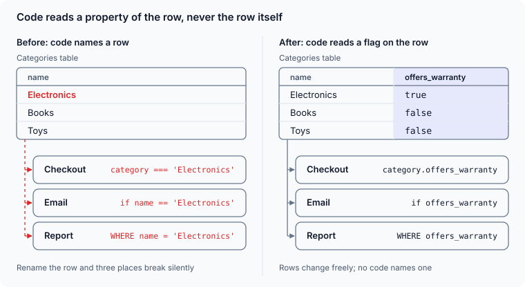
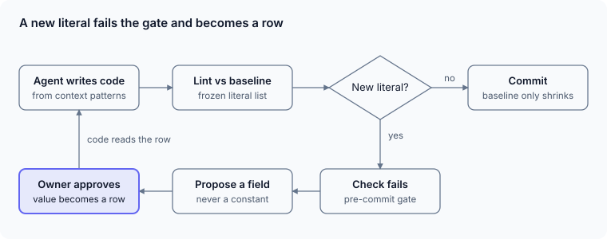

*Code holds mechanism; tables hold policy. When an LLM coding agent writes your code, that split is also a steering trick.*

## The rule

**No business data lives in code** — neither invented constants, nor values that already sit in a table. A magic number is the obvious case. The subtler one is code that names a row: `if (category === 'Electronics')`, a status string, a customer or product name, a row's id. That value already has a home in a table; writing it in code makes a second, invisible copy that silently breaks the day someone renames or replaces the row.

So none of it goes into backend logic, SQL queries, UI code, scripts or config files. Only technical constants stay: float epsilon, page sizes, timeouts, HTTP status codes.

The test is simple: if changing a value needs a *business* decision, it is data. If it needs only an *engineering* decision, it is code.

Take an online shop that offers an extended warranty on electronics. Written as `if (category === 'Electronics')`, the check copies a value the Categories table already holds. Soon the same string sits in checkout, the email template and the report, and all three break silently when the category is renamed or split. Give the category an `offers_warranty` flag instead: code filters on the flag, and the owner ticks it on the category's own screen.



## How code works instead

- **Code works on structure:** columns, foreign keys, flags. It reads every value from a defined row.
- **Behaviour is a flag on the row, not a list in code.** Instead of `if (category in [...])`, the category carries the attribute and the code filters on it.
- **A missing definition becomes a proposal**, never a constant: a new field, enum or rule table, approved by the owner and editable on its own screen.

## The trick for LLM coding agents

LLMs write code by completing patterns, and the shortest pattern is a literal. It works and tests pass — and the next generated file copies it, because that is what the model saw in context. In a codebase an agent writes, hardcoding is self-replicating. Four things reverse it:

1. **Name every forbidden place.** "No data in code" alone gets lawyered ("it's a SQL view, not code"). List each layer explicitly in the agent's instruction file.
2. **Name what is allowed.** Listing the technical constants draws the boundary from both sides, so the model neither over- nor under-applies the rule.
3. **Turn the escape hatch into a question.** "Propose a field, never add a constant" converts a silent guess into a design decision a human sees.
4. **Ratchet it with a linter.** Keep the remaining literals in a baseline file that may only shrink, and fail the pre-commit check on any new one.



The loop closes on itself: once the value is a row, the next generated code reads it, and the model sees one more example of the right shape.

## Why it makes an agent's work readable

An agent produces more code than a human can read line by line. The rule turns that problem into one you can manage, because it splits every change into two kinds a reviewer can tell apart at a glance:

- **A code diff is mechanism only.** If no business value may appear in code, a code change can only add or alter *how* something is computed. A reviewer asks one question — is the logic right? — instead of also hunting for which customer, category or limit the agent quietly baked in.
- **A behaviour change is a schema or data diff.** When the agent needs a new business fact, it must surface as a new column, flag or rule row. That diff is a few lines long and names the decision in plain words: `+ offers_warranty boolean`. You read the intent without reading the implementation.
- **The owner can check the result without reading code.** The value the agent introduced sits on a screen. Whether the warranty applies to Books is answered by looking at a row, not by tracing three files.
- **Drift is measurable.** The literal baseline is a number that only goes down. Any change that raises it is visible in CI before review, so an agent cannot reintroduce hidden data without it showing.
- **Every hidden assumption becomes a question.** "Propose a field, never add a constant" means the agent's guesses arrive as proposals, not as buried code. What the agent decided and what you decided stay separate and traceable.

The proof is in the diff itself. Without the rule, a change reads like this:

```diff
- if (category === 'Electronics') {
+ if (category === 'Electronics' || category === 'Phones') {
```

A business decision is hidden inside a code change, and it will be repeated in every other file that copied the string. With the rule, the same change is a single row edit — `Phones.offers_warranty = true` — and the code diff is empty. Nothing to review in code, one obvious line to approve in data.

The more of a codebase reads from rows, the more the model's own pattern-completion pulls toward the right shape. The rule shapes not just today's code, but the statistics of tomorrow's.
