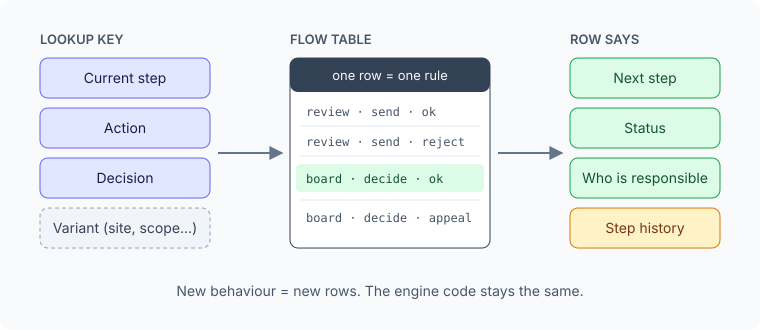

Notes from a case management system on SAP: a report comes in, gets reviewed, goes to a committee, is decided and closed. Two process families share the same backbone.

## Transitions are rows, not code

The core is a **data-driven state machine**. The engine looks up a row by `current step + action + decision`; the row says the next step, the status and who is responsible. Conditions like site or scope are a **variant key** on the row, not extra columns.

So the rule is: **no step-specific code.** A new step is a new row. Both processes run on one engine and one table.

## A registry for what doesn't fit

Rules that don't fit the model go into a **special case registry** instead of scattered `IF` blocks. No new special-case types are ever added, records are deactivated rather than deleted, and every active record must be covered by an end-to-end test.

## Two statuses, never mixed

The **internal status** is a small lifecycle set (created, waiting, rejected, done). The **external status** is the text each role sees. "Suspended" needed no new state, just a waiting step and a mapped text.

## The rule behind it all

**Full scope, fewest objects, least code.** Every new object is a permanent maintenance cost. Try a customizing row first, then an existing table or class, and only then something new.
