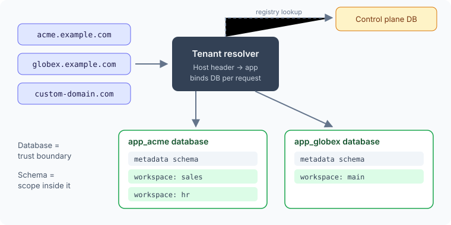

Deryo is a self-hosted app platform in the spirit of Airtable or Coda, built on PostgreSQL, FastAPI and React. Users define tables, views, relations and automations; the platform turns those definitions into a working app.

## Definitions are data

Column types, views and actions are stored as **metadata**, and the DDL is generated from them. Backend and frontend share the same four planes (`core · data · view · action`), so a feature can be traced from the grid to the SQL with the same words.

## One database per customer

One installation hosts many apps. Each request is resolved to its app from the Host header, and **each app has its own database**. A schema separates scopes inside one trust boundary; a database separates trust boundaries.

## One version, two runtimes

All production apps run one tagged version. Dev syncs from the local disk; prod only checks out tags from GitHub. Code never goes from dev to prod directly, because the dev tree contains uncommitted work.

## Migrations must not break the previous release

Rollback restores code, not schema, so new schema always runs with old code for a while. Changes go **add → read both → drop**, across releases, and a test scans migration files for renames and dropped columns.

Most of these choices are about **where a boundary sits**. Once it's in the right place, a lot else gets simpler.
