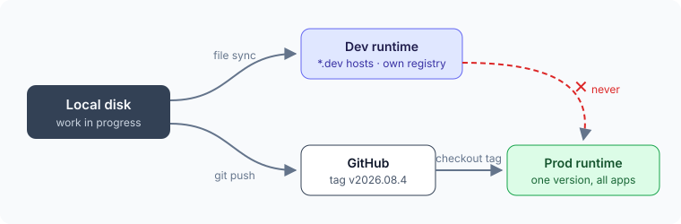

Deryo, Airtable ya da Coda tarzında, kendi sunucunda çalışan bir uygulama platformu; PostgreSQL, FastAPI ve React üzerine kurulu. Kullanıcılar tablolar, görünümler, ilişkiler ve otomasyonlar tanımlıyor; platform bu tanımları çalışan bir uygulamaya dönüştürüyor.

## Tanımlar veridir

Kolon tipleri, görünümler ve aksiyonlar **metadata** olarak saklanıyor ve DDL bunlardan üretiliyor. Backend ve frontend aynı dört katmanı (`core · data · view · action`) paylaşıyor; böylece bir özellik, griddeki görünümünden SQL'ine kadar aynı kelimelerle izlenebiliyor.

## Her müşteriye bir veritabanı

Tek bir kurulum birçok uygulamayı barındırıyor. Her istek Host başlığından ilgili uygulamaya çözümleniyor ve **her uygulamanın kendi veritabanı var**. Şema, tek bir güven sınırı içindeki kapsamları ayırıyor; veritabanı ise güven sınırlarını ayırıyor.

## Tek sürüm, iki çalışma ortamı

Tüm production uygulamaları etiketlenmiş tek bir sürümü çalıştırıyor. Dev, yerel diskten senkronize oluyor; prod ise GitHub'dan yalnızca etiketleri çekiyor. Kod hiçbir zaman dev'den prod'a doğrudan gitmiyor, çünkü dev ağacında commit edilmemiş işler bulunuyor.

## Migration'lar önceki sürümü bozmamalı

Rollback kodu geri getiriyor, şemayı değil; bu yüzden yeni şema bir süre her zaman eski kodla birlikte çalışıyor. Değişiklikler sürümler boyunca **ekle → ikisini de oku → kaldır** sırasıyla ilerliyor ve bir test, migration dosyalarını yeniden adlandırma ve silinen kolonlar için tarıyor.

Bu tercihlerin çoğu **bir sınırın nerede durduğuyla** ilgili. Sınır doğru yere oturunca geri kalan pek çok şey sadeleşiyor.
